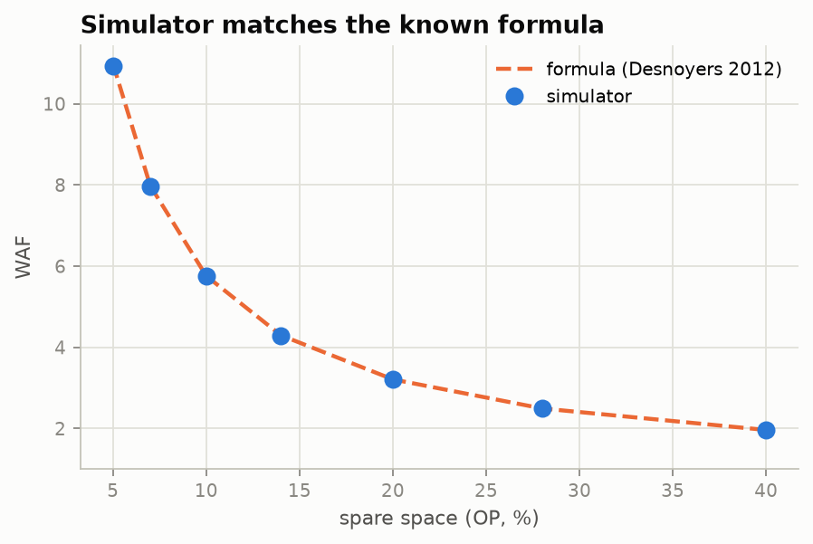
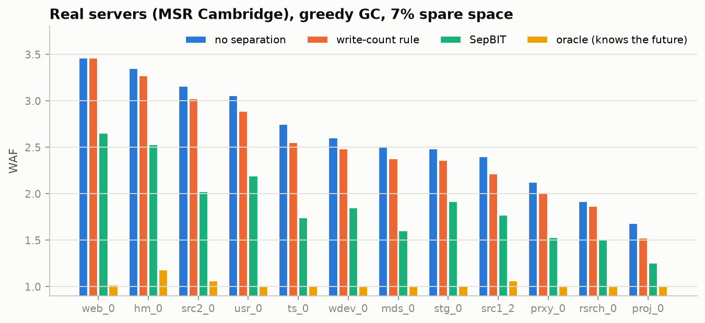
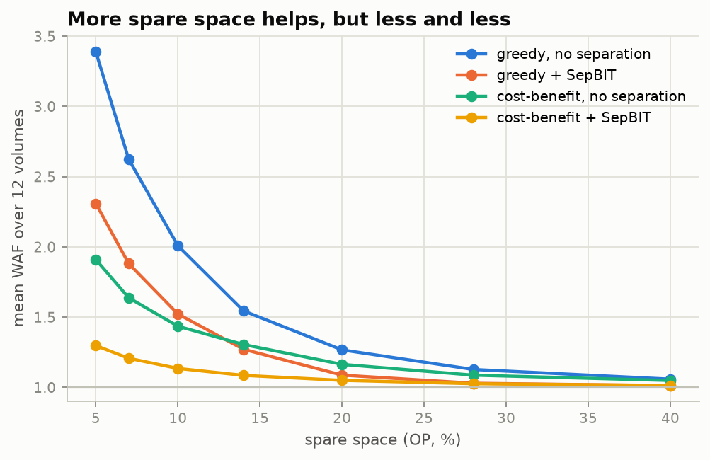
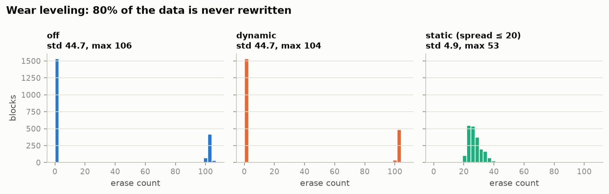

# ftlsim — SSD FTL Simulator

**English** | [繁體中文](README.zh-TW.md)

An SSD can't overwrite data in place. To update a page it writes the new copy
somewhere else, and later it has to clean up: pick a block, copy the pages that
are still valid to a new place, and erase the block. Those extra copies are
called write amplification. The part of the SSD firmware that does all this is
the FTL (Flash Translation Layer).

ftlsim is a small FTL written from scratch in C++. You feed it a list of disk
writes (made up, or recorded from real servers), and it tells you how much
extra writing the drive had to do. I use it to compare cleanup strategies, and
to test whether a small machine-learning model can sort hot and cold data
better than a hand-written rule.

A longer write-up of the results (in Traditional Chinese): [docs/article.zh-TW.md](docs/article.zh-TW.md).

## A few terms

- **WAF** (write amplification factor): data written to flash ÷ data the computer asked to write. 1.0 is perfect; 2.0 means every write cost two.
- **GC** (garbage collection): the cleanup step above. `greedy` cleans the block with the fewest valid pages. `cost-benefit` also prefers blocks whose data is old.
- **OP** (over-provisioning): spare space the user can't see. More spare space means GC finds emptier blocks, so WAF drops.
- **Hot/cold separation**: data that gets rewritten soon (hot) and data that sits for a long time (cold) are written into different blocks. Then a block tends to empty out all at once, and GC has less to copy.

## What it can do

- Page-level mapping, TRIM, three GC policies (`greedy`, `cost-benefit`, `fifo`).
- Data placement (where each write goes): no separation, write-count rule, [SepBIT](https://www.usenix.org/conference/fast22/presentation/wang) (a published rule-based method used in production at Alibaba), an "oracle" that knows the future (upper bound), NVMe FDP host hints, and a decision-tree predictor.
- Wear leveling (keeping erase counts even across blocks): dynamic and static.
- Synthetic workloads (sequential, uniform random, 80/20, Zipf) and real block traces (MSR Cambridge, Alibaba, Tencent).
- A shadow copy that checks every read returns the latest data, so a bug can't hide behind plausible numbers.

## Build and run

Needs `g++` (C++17) and `make`. I develop on WSL2 Ubuntu.

```bash
make            # builds build/ftlsim and build/test_ftl
make test       # correctness tests
./build/ftlsim --workload=zipf --gc=greedy --placement=sepbit --op=0.14
./build/ftlsim --help
```

The output is one JSON object: WAF, number of GC runs, erase-count spread, and so on.

A run first fills the whole drive once, then writes `--warmup` × capacity
(not measured), then `--writes` × capacity (measured). The whole run is
recorded first and replayed, so every placement method sees exactly the same
writes.

### Real traces

Traces from SNIA IOTTA have to be downloaded by hand in a browser (the site
blocks scripts). Put the MSR Cambridge `.tar` files in `trace/`, then:

```bash
bash scripts/prep_msr.sh trace     # unpack and convert 12 volumes
python3 scripts/experiment.py --grid trace --traces trace/unified/*.csv --out results/msr_grid.csv
```

Other formats: `python3 tools/convert_trace.py {msr|alibaba|tencent} <file> -o out.csv`,
then `./build/ftlsim --trace=out.csv --size-to-trace`.

### Figures

```bash
bash scripts/figure_data.sh     # runs the experiments behind the figures
uv run scripts/plots.py         # writes docs/figures/*.png
```

### Machine-learning predictor

```bash
bash scripts/ml_pipeline.sh zipf 0.14     # synthetic: train on one run, test on another
bash scripts/ml_traces.sh trace/unified "hm_0 proj_0" "mds_0 ts_0" 0.07   # train on some volumes, test on others
```

Training runs in Python with scikit-learn through [uv](https://docs.astral.sh/uv/).
The tree is saved as a plain node table (about 1.2 KB for 123 nodes) that the
C++ side loads. The features it uses need 2 bytes of memory per logical page.

## Is the simulator right?

- Rewriting the drive sequentially gives WAF exactly 1.00000 with every GC policy.
- For FIFO cleanup with uniform random writes there's a known formula (Desnoyers, SYSTOR'12). From 5% to 40% OP the simulator stays within 0.1–0.5% of it.
- The shadow copy check passes in the tests for every GC policy, every placement method, and both kinds of wear leveling.



## Results

### Real servers (MSR Cambridge, 12 volumes)

Average WAF across 12 volumes. Lower is better.

| GC, spare space | no separation | write-count rule | SepBIT | oracle |
|---|---|---|---|---|
| greedy, 7% | 2.63 | 2.50 | 1.88 | 1.03 |
| greedy, 14% | 1.54 | 1.47 | 1.27 | 1.00 |
| cost-benefit, 7% | 1.64 | 1.55 | 1.21 | 1.02 |



The oracle gets close to 1.0 on every volume, so on real data there's a lot to
gain from knowing how long data will live. SepBIT gets a good part of the way;
counting writes per address helps much less.

### How much spare space is enough?



Each extra percent of spare space buys less than the one before. With greedy
GC and no separation, going from 5% to 7% saves 0.38 WAF per percent; past 20%
it saves under 0.02. Around 10–14% is where it flattens, both on the real
traces and on synthetic workloads (`python3 scripts/op_knee.py results/msr_op.csv`).

Hot/cold separation is worth spare space: greedy + SepBIT at 14% (1.27) does as
well as no separation at 20% (1.27). That is about 6% of the drive's capacity
handed back to the user.

Then the ML part (greedy, 7%):

- Trained on 5 volumes and tested on 7 others it had never seen, the decision tree did worse than SepBIT on 6 of 7 (it edged ahead only on src1_2: 1.74 vs 1.77).
- Trained on a volume's own data, it beat SepBIT on 2 of 4 (mds_0 1.58 vs 1.60, wdev_0 1.75 vs 1.85).
- Letting SepBIT decide first and using the tree only to split the rest lands within about 4% of SepBIT, either way.

To find out why it loses, I ran `bash scripts/ml_compare.sh` (same 5 training
and 7 test volumes, SepBIT's GC rules for every method):

- More data doesn't help: gradient boosting trained on 1% of the rows already
  predicts lifetime with R² 0.848; all 5.6 million rows only get it to 0.854.
- A bigger model helps a little, not enough: going from a 1.3 KB tree to a
  79 KB gradient-boosted model (100 trees) lowers the average WAF over the 7
  volumes from 2.02 to 1.90, still behind SepBIT's 1.81.
- Three extra features (hour of day, position on the drive, seconds since the
  last write) don't help: R² barely moves and WAF gets slightly worse.

So the limit is information. What the drive can see on its own, SepBIT's simple
rule already uses well. The gap to the oracle is real, but the missing
information lives on the host (which file, which application), and a bigger
model can't make it up.

### Synthetic workloads

- Zipf writes, 14% OP: SepBIT cuts WAF from 4.62 to 3.55. On uniform random writes no separation helps; extra open blocks just eat spare space.
- `cost-benefit` beats `greedy` when writes are skewed and loses when they're uniform.
- FDP host hints: perfect hints give 1.93. If half the hints are wrong and GC must keep data inside the hinted group, WAF is 5.03, worse than no hints (4.62). If the drive is allowed to regroup data during GC, it drops to 4.14.
- Wear leveling on a drive where 80% of the data is never rewritten:

  

  Dynamic wear leveling does nothing here: it only picks among free blocks, and the blocks holding cold data never become free. Static wear leveling moves the cold data out, so the spread (std) drops from 44.7 to 4.9 for 7% more WAF. Where the cold data goes matters: putting it back with hot data raised WAF from 1.16 to 3.68 in a test; parking it on the most-worn free block kept it at 1.33.

## Limitations

- Writes smaller than 4 KiB are counted as full-page writes.
- For real traces only writes are kept, and the address space is squeezed to the part that was actually written (in 1 MiB chunks).
- No timing model: it measures write amplification, not latency.

## Layout

```
src/        simulator (nand, ftl, gc_policy, placement, predictor, workload, sim, main)
tests/      correctness tests
tools/      trace converters
scripts/    experiment grids, ML training and pipelines
```
