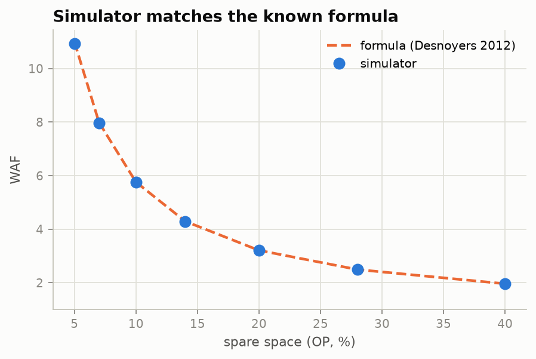
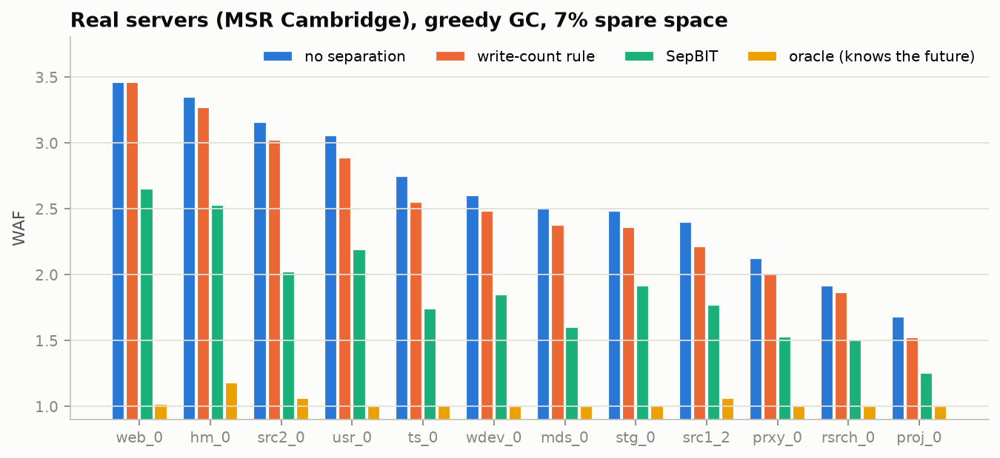
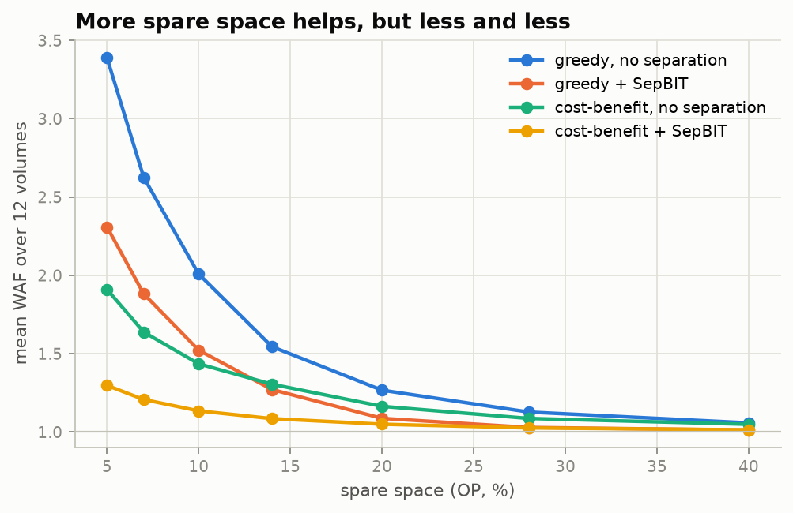
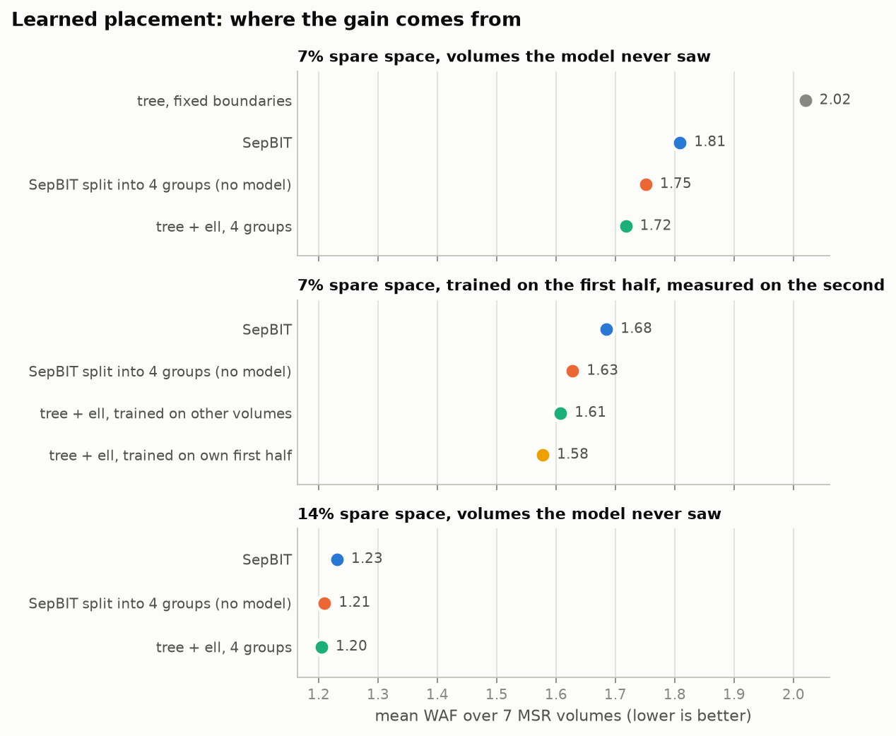
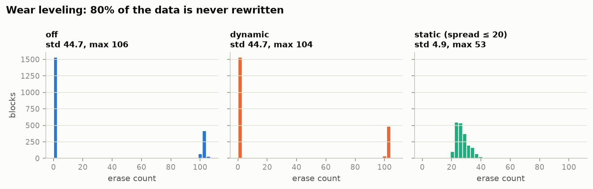

# ftlsim — SSD FTL 模擬器

[English](README.md) | **繁體中文**

SSD 不能直接覆寫舊資料。要更新一個 page，它會把新資料寫到別的地方，之後再回頭清理：挑一個 block，把裡面還有用的 page 搬走，再整塊抹除。這些額外搬移的量就叫寫入放大。SSD 韌體裡負責做這些事的部分叫 FTL（Flash Translation Layer）。

ftlsim 是我從零用 C++ 寫的小型 FTL。餵給它一串硬碟寫入紀錄（可以是自己產生的，也可以是真實伺服器錄下來的），它會算出 SSD 實際多寫了多少。我用它來比較不同的清理策略，也用來測試小型機器學習模型能不能比手寫規則更會分冷熱資料。

完整的結果整理成一篇文章：[docs/article.zh-TW.md](docs/article.zh-TW.md)。

## 幾個名詞

- **WAF**（寫入放大倍率）：實際寫進 flash 的量 ÷ 電腦要求寫的量。1.0 最好；2.0 代表每寫一次要付出兩次的代價。
- **GC**（垃圾回收）：就是上面說的清理步驟。`greedy` 挑有效 page 最少的 block；`cost-benefit` 還會偏好資料比較舊的 block。
- **OP**（預留空間）：使用者看不到的備用空間。備用空間越多，GC 越容易找到幾乎空的 block，WAF 就越低。
- **冷熱分離**：很快會被改寫的資料（熱）和放很久不動的資料（冷）分開寫到不同的 block。這樣一個 block 比較容易整塊一起失效，GC 要搬的就少了。

## 功能

- page 層級的位址對應、TRIM、三種 GC 策略（`greedy`、`cost-benefit`、`fifo`）。
- 資料擺放方式（每筆寫入要放到哪裡）：不分冷熱、依寫入次數、[SepBIT](https://www.usenix.org/conference/fast22/presentation/wang)（已發表、在阿里雲實際上線的規則式方法）、知道未來的「oracle」（理論上限）、NVMe FDP 主機提示，以及決策樹預測器。
- Wear leveling（讓每個 block 的抹除次數平均）：動態與靜態兩種。
- 合成 workload（循序、均勻隨機、80/20、Zipf）和真實的 block trace（MSR Cambridge、Alibaba、Tencent）。
- 影子對照表：每次讀取都檢查讀到的是不是最新的資料，避免程式有 bug 但數字看起來合理。

## 編譯與執行

需要 `g++`（C++17）和 `make`，我在 WSL2 Ubuntu 上開發。

```bash
make            # 產生 build/ftlsim 和 build/test_ftl
make test       # 正確性測試
./build/ftlsim --workload=zipf --gc=greedy --placement=sepbit --op=0.14
./build/ftlsim --help
```

輸出是一個 JSON 物件，包含 WAF、GC 次數、抹除次數的分布等等。

每次執行會先把整顆 SSD 寫滿一次，再寫 `--warmup` 倍容量（不計入結果），最後寫 `--writes` 倍容量（計入結果）。整段寫入會先錄下來再重播，所以每種擺放方式拿到的寫入完全一樣。

### 真實 trace

SNIA IOTTA 上的 trace 要用瀏覽器手動下載（網站會擋程式）。把 MSR Cambridge 的 `.tar` 檔放進 `trace/`，然後：

```bash
bash scripts/prep_msr.sh trace     # 解壓並轉換 12 個 volume
python3 scripts/experiment.py --grid trace --traces trace/unified/*.csv --out results/msr_grid.csv
```

其他格式：`python3 tools/convert_trace.py {msr|alibaba|tencent} <檔案> -o out.csv`，再執行 `./build/ftlsim --trace=out.csv --size-to-trace`。

### 圖表

```bash
bash scripts/figure_data.sh     # 跑出圖表需要的實驗資料
bash scripts/ml_cost.sh && bash scripts/ml_online.sh   # ml.png 的資料（需要 MSR trace）
uv run scripts/plots.py         # 產生 docs/figures/*.png
```

### 機器學習預測器

```bash
bash scripts/ml_pipeline.sh zipf 0.14     # 合成資料：用一次執行訓練，用另一次測試
bash scripts/ml_traces.sh trace/unified "hm_0 proj_0" "mds_0 ts_0" 0.07   # 用部分 volume 訓練，在其他 volume 測試
```

訓練用 Python 的 scikit-learn，透過 [uv](https://docs.astral.sh/uv/) 執行。決策樹存成簡單的節點表（123 個節點約 1.2 KB），由 C++ 端讀進來。它用到的特徵，每個邏輯 page 需要 2 bytes 記憶體。

## 模擬器算得對嗎？

- 循序覆寫整顆 SSD，每種 GC 策略的 WAF 都剛好是 1.00000。
- FIFO 清理搭配均勻隨機寫入有已知的公式（Desnoyers，SYSTOR'12）。OP 從 5% 到 40%，模擬結果和公式都只差 0.1–0.5%。
- 測試裡每種 GC 策略、每種擺放方式、兩種 wear leveling 都通過影子對照表檢查。



## 結果

### 真實伺服器（MSR Cambridge，12 個 volume）

12 個 volume 的平均 WAF，越低越好。

| GC、預留空間 | 不分冷熱 | 依寫入次數 | SepBIT | oracle |
|---|---|---|---|---|
| greedy，7% | 2.63 | 2.50 | 1.88 | 1.03 |
| greedy，14% | 1.54 | 1.47 | 1.27 | 1.00 |
| cost-benefit，7% | 1.64 | 1.55 | 1.21 | 1.02 |



oracle 在每個 volume 都接近 1.0，表示在真實資料上，只要知道資料會活多久，就能省下很多寫入。SepBIT 拿到了其中不少；只算每個位址被寫了幾次的效果就差很多。

### 預留空間要多少才夠？



預留空間每多 1%，省下的寫入就比前一個 1% 少。greedy GC、不分冷熱時，OP 從 5% 加到 7%，每 1% 讓 WAF 降 0.38；超過 20% 之後，每 1% 只降不到 0.02。大約在 10–14% 開始變平，真實 trace 和合成 workload 都一樣（`python3 scripts/op_knee.py results/msr_op.csv`）。

冷熱分離可以換到預留空間：greedy + SepBIT 在 OP 14% 時是 1.27，和不分冷熱、OP 20% 的 1.27 一樣。等於多還給使用者大約 6% 的容量。

接著是機器學習的部分（greedy，7%）：

- 用 5 個 volume 訓練、在另外 7 個沒看過的 volume 測試，決策樹有 6 個輸給 SepBIT，只有 src1_2 小贏（1.74 對 1.77）。
- 改用 volume 自己的資料訓練，4 個裡贏了 2 個（mds_0 1.58 對 1.60，wdev_0 1.75 對 1.85）。
- 讓 SepBIT 先判斷，決策樹只負責細分剩下的資料，結果和 SepBIT 相差都在 4% 左右以內，有好有壞。

為了確認輸的原因，我又跑了 `bash scripts/ml_compare.sh`（一樣 5 個訓練、7 個測試，GC 都用 SepBIT 的規則）：

- 資料量不是問題：Gradient Boosting 只用 1% 的訓練資料，預測壽命的 R² 就有 0.848，用全部 564 萬筆也只到 0.854。
- 模型變大有一點用但不夠：從 1.3 KB 的決策樹換成 79 KB 的 Gradient Boosting（100 棵樹），7 個 volume 的平均 WAF 從 2.02 降到 1.90，還是輸 SepBIT 的 1.81。
- 加三個新特徵（一天中的哪個小時、位址在碟上的位置、離上次寫入過了幾秒）沒有幫助：R² 幾乎不變，WAF 還略差。

所以光是換模型、加特徵都贏不了。離 oracle 的差距是真的存在，但很大一塊缺的資訊在主機那邊（哪個檔案、哪個應用程式）。

後來我發現問題出在用法，不在模型（`bash scripts/ml_cost.sh`）。原本模型用固定的分界判斷冷熱（例如「活不到容量的 1/8 算熱」）。改成拿預測的壽命跟 SepBIT 的動態門檻 ℓ 比（ℓ 是最近被回收的熱 block 平均活了多久），再把不熱的資料依 4ℓ、16ℓ 細分成 3 組：

| 方法 | 7 個 volume 平均 WAF | 贏 SepBIT 幾個 |
|---|---|---|
| SepBIT | 1.81 | |
| 決策樹，固定分界 | 2.02 | 1 |
| SepBIT 規則切 4 組（對照組，沒有模型） | 1.75 | 7 |
| 決策樹 + ℓ，4 組 | 1.72 | 7 |

同一棵 1.3 KB 的決策樹，WAF 從 2.02 降到 1.72。不過要誠實地扣掉組數變多的功勞：不用模型、只把 SepBIT 切成同樣 4 組就有 1.75。所以進步裡大約 3/5 來自多分組，2/5 來自模型。另外也試了讓模型「不輕易判成熱」的不對稱訓練（quantile loss），只在固定分界時有幫助（2.02 → 1.89），用 ℓ 之後就沒差了。

兩個補充檢查：
- 只用 volume 自己前半段的資料訓練、在後半段測（`bash scripts/ml_online.sh`）：平均 1.58，SepBIT 1.68，4 組對照組 1.63，7 個裡贏對照組 5 個。
- OP 14% 時，模型和 4 組對照組打平（都是 1.21，SepBIT 1.23）。備用空間多時，模型的優勢就不見了。

再檢查三件事（都是 OP 7%、同樣 5 個訓練、7 個測試）：

- **換 seed 還在嗎**（`bash scripts/ml_seeds.sh`）：用 5 組不同的 seed 重新抽訓練資料、重新訓練，模型平均 1.714，標準差 0.007；比對照組好 0.037 ± 0.007，最差的 seed 也好 0.033。7 個 volume 贏 6 個（配對 t 檢定 p = 0.04）。所以模型的貢獻不是運氣，但量不大，而且 web_0 佔了最多（不算它，其他 6 個平均好 0.025）。
- **分更多組會更好嗎**（`bash scripts/ml_splits.sh`）：2 → 3 → 4 組明顯變好，再多就沒有了。規則版 4 組 1.75、6 組 1.75、8 組 1.75；分界點選 2ℓ/8ℓ、4ℓ/16ℓ 或 8ℓ/64ℓ 差不多。OP 14% 時 8 組反而比 4 組差，多開的寫入點會吃備用空間。
- **讓模型直接學它要回答的問題**（`bash scripts/ml_ell_target.sh`）：模型原本學「活多久（以容量為單位）」，但用的時候是跟 ℓ 比。改成把當下的 ℓ 當特徵、直接學「活多久 ÷ ℓ」，3 組 seed 平均 1.694，是目前最好的；但跟原本相比只有 7 個裡 4 個比較好（p = 0.38），還不能說一定比較好。改成直接分類「放第幾組」反而沒用（1.749，跟對照組一樣），雖然分類準確率比 SepBIT 的規則還高（0.72 對 0.68）。

另外修了一個不公平的地方：模型版原本多報了一個寫入點，GC 因此多留了一個空 block，等於讓模型吃了一點虧。修正後模型從 1.72 變 1.714；只分 2 組時是 1.79，比 SepBIT 的 1.81 好一點點（7 個贏 3 個），差別不大。



### 合成 workload

- Zipf 寫入、OP 14%：SepBIT 把 WAF 從 4.62 降到 3.55。均勻隨機寫入下怎麼分都沒用，多開的寫入點只會吃掉備用空間。
- 寫入偏斜時 `cost-benefit` 比 `greedy` 好，均勻寫入時反而比較差。
- FDP 主機提示：提示完全正確時是 1.93。如果一半的提示是錯的，而且 GC 只能在原本的分組內搬資料，WAF 是 5.03，比完全不分（4.62）還差；如果允許 SSD 在 GC 時自己重新分組，可以降到 4.14。
- 80% 資料永遠不改寫時的 wear leveling：

  

  動態 wear leveling 在這裡完全沒用：它只會在空的 block 之間挑，而存放冷資料的 block 永遠不會變空。靜態 wear leveling 會主動把冷資料搬走，抹除次數的標準差從 44.7 降到 4.9，代價是 WAF 多 7%。冷資料搬去哪很重要：在測試裡，把它放回熱資料的 block 會讓 WAF 從 1.16 升到 3.68；改放到抹除次數最高的空 block，只升到 1.33。

## 限制

- 小於 4 KiB 的寫入當作整頁寫入。
- 真實 trace 只保留寫入，而且位址會壓縮到實際寫過的範圍（以 1 MiB 為單位）。
- 沒有時間模型：只量寫入放大，不量延遲。

## 目錄結構

```
src/        模擬器（nand、ftl、gc_policy、placement、predictor、workload、sim、main）
tests/      正確性測試
tools/      trace 轉換工具
scripts/    實驗矩陣、ML 訓練與流程
```
