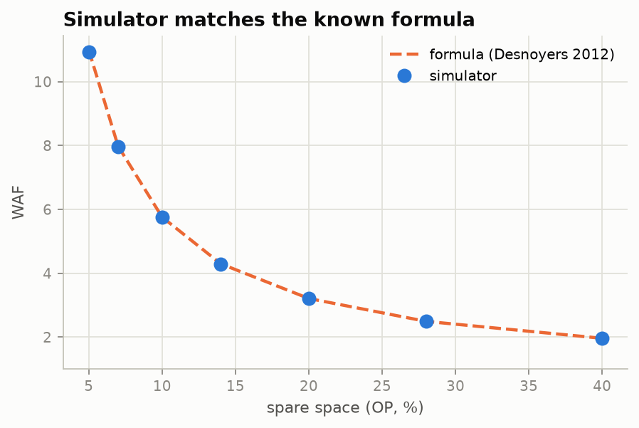
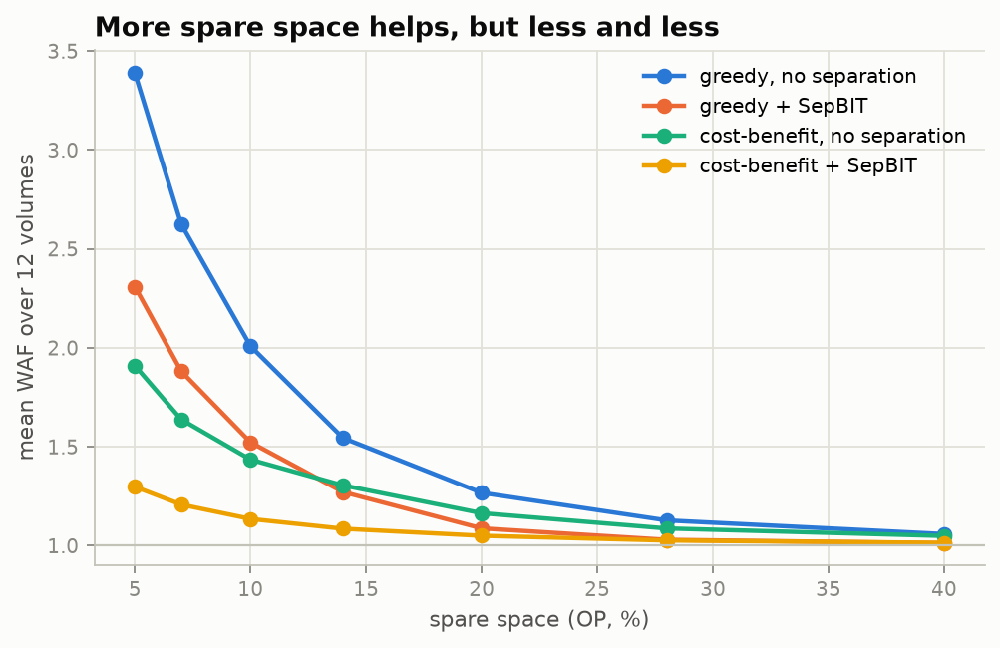
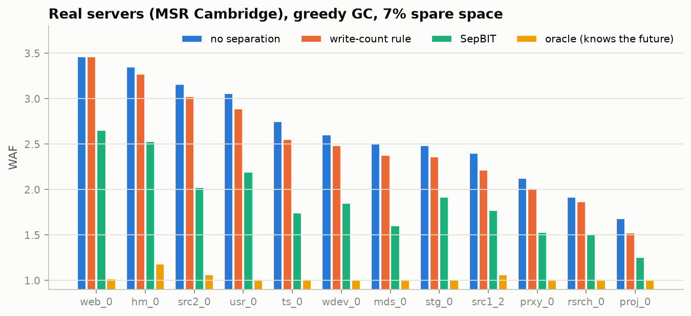
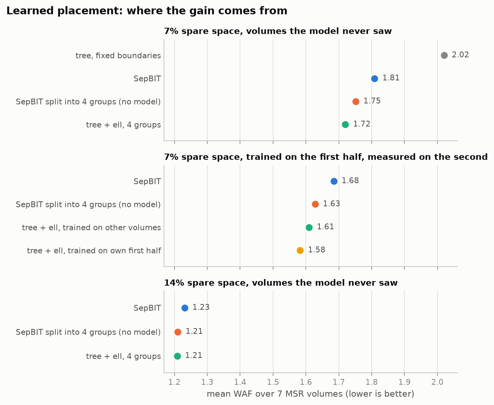
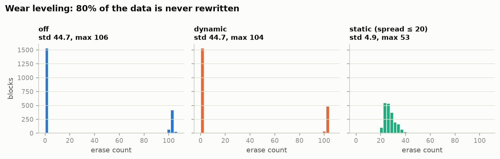

# 從零寫一個 FTL：OP、GC 策略和冷熱分離各值多少 WAF

這篇記錄我自己寫一個 SSD 模擬器、拿真實伺服器的寫入紀錄去跑的過程。想回答的問題很實際：一顆 SSD 的韌體裡，哪些設計真的能少寫一點 flash，各省多少，還有「用 AI 預測資料冷熱」到底有沒有用。

程式在 [ftl-sim](https://github.com/KJLavender/ftl-sim)。

## 先講 SSD 為什麼會多寫

NAND flash 有兩個麻煩的限制：寫入以 page（這裡是 4 KB）為單位，抹除卻要以 block（幾百個 page）為單位；而且已經寫過的 page 不能直接覆蓋。

所以電腦要更新一筆資料時，SSD 只能把新版本寫到別的空 page，再把舊的那份標成「無效」。空間總有用完的一天，這時韌體要做垃圾回收（GC）：挑一個 block，把裡面還有效的 page 搬到別處，然後整塊抹掉。

搬的那些 page，電腦從來沒要求寫，是 SSD 自己多寫的。這就是寫入放大，用 WAF 表示：

> WAF = 實際寫進 flash 的量 ÷ 電腦要求寫的量

WAF 2 代表每寫 1 份要付出 2 份的代價：速度變慢、flash 也老得更快。負責位址對應和 GC 的這層韌體，就叫 FTL（Flash Translation Layer）。

## 怎麼確定模擬器沒寫錯

模擬器最怕的是：有 bug，但跑出來的數字看起來很合理。我用了三道檢查：

1. **影子對照表**：另外記一份「每個位址最後一次寫的是哪個版本」，每次讀取都比對 SSD 回傳的是不是那一份。
2. **循序覆寫**：從頭到尾依序重寫整顆 SSD，每個 block 都會整塊失效，GC 不用搬任何東西，WAF 必須剛好是 1。結果是 1.00000。
3. **對公式**：FIFO 式的 GC 搭配均勻隨機寫入，有已知的數學公式（Desnoyers，SYSTOR 2012）。OP 從 5% 到 40%，模擬結果和公式只差 0.1–0.5%。

第三點有個小插曲：一開始在小容量的設定下，誤差有 3.6%。查下去發現 GC 為了不卡死，平常會保留幾個空 block 不用，還有正在寫的 block 也還沒滿，這些都吃掉了一部分預留空間。把這部分扣掉、改用「實際能用的 OP」去算之後，誤差就降到 1% 以內。這也說明多開寫入點不是免費的，每多一個都要多佔一塊空間。

## 真實資料：MSR Cambridge

合成的 workload 好控制，但不一定像真的。我用了 SNIA 上公開的 MSR Cambridge trace，裡面是 2007 年微軟劍橋研究院 13 台伺服器、36 個 volume 一週的 I/O 紀錄。我挑了 12 個寫入比較多的 volume，只保留寫入，把位址壓縮到實際寫過的範圍，每個 trace 重播兩次，第一次當暖機、第二次才計分。

## 結果一：預留空間要多少才夠

預留空間（OP）是使用者看不到的備用容量。OP 越多，GC 越容易找到幾乎空的 block，要搬的就越少。

但效益遞減得很快。greedy GC、不分冷熱時，OP 從 5% 加到 7%，每多 1% 讓 WAF 降 0.38；超過 20% 之後，每多 1% 只降不到 0.02。不管是真實 trace 還是合成資料，曲線大約都在 10–14% 開始變平。

這可以用來理解常見的產品配置：消費級 SSD 的預留空間常常只有 7% 左右（大致就是 GB 和 GiB 的差距），寫入量大的企業級產品則常給到 28% 或更多。一般使用者很少長時間把整顆碟隨機寫滿，企業級要扛的正是這種情況。

## 結果二：GC 挑誰回收

最直覺的做法是 greedy：挑有效 page 最少的 block，眼前要搬的最少。另一種是 cost-benefit：同時考慮資料的年紀，偏好資料比較舊的 block，因為舊資料比較可能一直放著不動，搬一次就能撐很久。

結果是看 workload：

- 均勻隨機寫入時，所有資料一樣熱，年紀沒有意義，greedy 比較好（OP 7%：7.73 對 9.17）。
- 寫入偏斜時（少數資料很熱），cost-benefit 好很多（Zipf、OP 7%：5.79 對 7.50）。
- 真實 trace 是偏斜的：12 個 volume 平均下來，OP 7% 時 cost-benefit 是 1.64，greedy 是 2.63。

## 結果三：冷熱分離值多少

冷熱分離就是把很快會被改寫的資料（熱）和很久不動的資料（冷）寫到不同的 block。一個 block 裡的資料如果差不多同時失效，GC 挑到它時幾乎不用搬。

我比了四種做法：

| 平均 WAF（12 個 volume，greedy，OP 7%） | |
|---|---|
| 不分冷熱 | 2.63 |
| 依寫入次數分（寫越多次越熱） | 2.50 |
| SepBIT（FAST 2022，阿里雲實際在用） | 1.88 |
| oracle：直接偷看未來，知道每筆資料什麼時候會被改寫 | 1.03 |

幾個觀察：

- 「依寫入次數」這種最直覺的規則效果很小。
- SepBIT 的想法很簡單：一筆資料這次被覆寫時，看它上一個版本活了多久；活得比最近的平均短，就當成熱資料。GC 搬出來的資料再依年紀分組。就這樣，平均把 WAF 從 2.63 降到 1.88。
- oracle 在每個 volume 都接近 1.0，代表真實資料的壽命原則上是可以預測的，還有很大的進步空間。

把結果一和結果三放在一起看，可以換算成容量：greedy + SepBIT 在 OP 14% 時的 WAF（1.27），和不分冷熱時要 OP 20% 才達到的一樣。也就是說，冷熱分離大約幫使用者省回 6% 的容量。

## 結果四：用 AI 預測冷熱，有用嗎

既然 oracle 離 SepBIT 還很遠，很自然會想：能不能訓練一個模型來預測資料會活多久？

我做的是韌體放得下的版本：一棵深度 6 的決策樹，123 個節點、大約 1.2 KB；用到的特徵只有寫入次數、上次活多久、附近位址的活躍程度、請求大小，每個邏輯 page 只要 2 bytes 的狀態。

結果不太好：

- 用 5 個 volume 訓練、在另外 7 個沒看過的 volume 上測，有 6 個輸給 SepBIT。
- 改成用同一個 volume 自己的資料訓練（模擬 SSD 在客戶手上自己學），4 個裡贏了 2 個。
- 讓 SepBIT 先判斷，模型只負責把 SepBIT 沒把握的部分再細分，結果和 SepBIT 差不到 4%，有好有壞。

為什麼輸？可能是資料不夠、模型太小，或是特徵裡本來就沒有足夠的資訊。我把三個都試了一遍（`scripts/ml_compare.sh`，一樣用 5 個 volume 訓練、7 個沒看過的 volume 測試，greedy、OP 7%，GC 都用 SepBIT 的規則，所以差別只在主機寫入怎麼分）：

| 方法 | 模型大小 | 預測壽命的 R² | 7 個 volume 平均 WAF | 贏 SepBIT 幾個 |
|---|---|---|---|---|
| 不分冷熱 | | | 2.54 | |
| SepBIT | | | 1.81 | |
| 決策樹，深度 6 | 1.3 KB | 0.830 | 2.02 | 1 |
| 決策樹，深度 12 | 34 KB | 0.845 | 1.90 | 3 |
| Gradient Boosting，100 棵樹 | 79 KB | 0.853 | 1.90 | 3 |
| 深度 6 + 3 個新特徵 | 1.3 KB | 0.825 | 2.04 | 1 |
| Gradient Boosting + 3 個新特徵 | 79 KB | 0.854 | 1.94 | 2 |
| oracle | | | 1.01 | |

新特徵是寫入發生在一天中的哪個小時、位址在碟上的位置、離上次寫入實際過了幾秒（最後這個每個邏輯 page 要多 4 bytes）。

- **資料量不是問題**：Gradient Boosting 只拿 1% 的訓練資料（5.6 萬筆），R² 就有 0.848；用全部 564 萬筆也只到 0.854。
- **模型變大有一點幫助，但不夠**：從 1.3 KB 換到 79 KB，平均 WAF 從 2.02 降到 1.90，還是輸 SepBIT 的 1.81。韌體記憶體多 60 倍，換不到贏過規則。
- **新特徵沒有幫助**：R² 幾乎沒變，WAF 反而略差。

所以光是換模型、加特徵都贏不了。oracle 的 1.01 說明空間還很大，但很大一塊缺的資訊在主機那邊，例如這筆資料屬於哪個檔案、哪個應用程式。這也是下一節 FDP 在做的事。

### 換個問法：不是猜準，是猜得對 WAF 有用

回頭看，準度本身就是錯的目標。全部猜「短命」就有 80% 的準度，因為熱資料一直被改寫，寫入次數都被它佔走了；真正決定 WAF 的是少數難判斷的資料。我試了兩個改法（`scripts/ml_compare.sh` 同一組 volume，`scripts/ml_cost.sh`）：

1. **不對稱的代價**：把冷資料放進熱的 block，GC 回收時就得搬它；把熱資料放進冷的 block，只是暫時浪費一格。所以訓練時改成預測壽命的較高分位數（quantile 0.7、0.85），讓模型不輕易把資料判成熱的。
2. **用 SepBIT 的動態門檻 ℓ**：ℓ 是最近被回收的熱 block 平均活了多久，會跟著 workload 自動調整。原本模型用固定的分界（例如「活不到容量的 1/8 算短命」），現在改成拿預測的壽命跟 ℓ 比：小於 ℓ 放熱組（ell2）；其餘再依 4ℓ、16ℓ 切成 3 組（ell4）。

| 方法 | 7 個 volume 平均 WAF | 贏 SepBIT 幾個 |
|---|---|---|
| SepBIT | 1.81 | |
| 決策樹，固定分界 | 2.02 | 1 |
| 決策樹，固定分界 + quantile 0.85 | 1.89 | 3 |
| 決策樹 + ℓ，2 組（ell2） | 1.81 | 3 |
| SepBIT 規則切 4 組（對照組，沒有模型） | 1.75 | 7 |
| **決策樹 + ℓ，4 組（ell4）** | **1.72** | **6** |
| Gradient Boosting + ℓ，4 組 | 1.71 | 6 |

- **動態 ℓ 是關鍵**：同一棵 1.3 KB 的決策樹，從固定分界換成跟 ℓ 比，WAF 從 2.02 降到 1.72，第一次在沒看過的 volume 上贏過 SepBIT。
- **但要扣掉「組數變多」的功勞**：ell4 用了 4 個熱度分組，SepBIT 只有 2 個。所以我加了對照組：不用模型，SepBIT 原本的規則一樣切 4 組，結果是 1.75。從 1.81 到 1.72 的進步裡，大約 2/3 來自多分組，1/3 來自模型。模型對對照組還是 7 個贏 6 個。
- **ell2 和 SepBIT 幾乎一樣（1.81）**：只判斷「熱或不熱」的話，模型和「上一版活多久」一樣好。模型真正多出來的價值，是把不熱的資料再細分。
- **不對稱代價只在固定分界時有用**：固定分界時 2.02 → 1.89，換成 ℓ 之後就沒差了（1.72 對 1.73）。ℓ 本身就會依實際情況調整，固定分界的偏差它已經修掉了。
- **模型大小幾乎不重要**：決策樹 1.72，79 KB 的 Gradient Boosting 1.71。

再做兩個檢查：

- **在 SSD 上用自己的過去學（`scripts/ml_online.sh`）**：每個 volume 的 trace 從時間中間切開，只用前半段訓練，只在後半段量 WAF，模型完全沒看過測試的那段。後半段的平均 WAF：SepBIT 1.68、SepBIT 切 4 組 1.63、別的 volume 訓練的模型 1.61、**自己前半段訓練的模型 1.58**。跟同樣 4 組的對照組比，7 個贏 5 個。所以讓 SSD 依自己的 workload 學，比拿一個通用模型好一點。
- **OP 改成 14%**：SepBIT 1.23、SepBIT 切 4 組 1.21、決策樹 + ℓ 4 組 1.21。平均打平，7 個只贏 2 個，平均還是靠 web_0 一個拉起來的。備用空間比較多時，GC 壓力小，模型多出來的那一點就不見了，剩下的進步都來自多分組。

結論改成：AI 不是贏在預測得比較準，而是要把它放在對的位置。哪些資料最熱，SepBIT 的規則已經判斷得夠好；模型適合用來把剩下的資料再分細一點，判斷的門檻則交給 ℓ 自動調整。

## 結果五：主機告訴 SSD 呢

NVMe 有個新功能叫 FDP（Flexible Data Placement）：主機寫入時順便標註「這筆資料屬於哪一組」，SSD 就把同組的放在一起。Google、Meta 都在推。

我在合成的 Zipf workload 上模擬了不同品質的提示（OP 14%）：

| 主機提示 | GC 只能在原組內搬 | SSD 可以重新分組 |
|---|---|---|
| 完全正確 | 1.93 | 1.74 |
| 一半是錯的 | 5.03 | 4.14 |
| 不分冷熱（對照） | 4.62 | |

提示錯一半，而且 SSD 只能照主機的分組搬，結果比完全不分還差。讓 SSD 在 GC 時可以依自己的判斷重新分組，就能救回大部分。這和 WARP（FAST 2026）在真實 FDP SSD 上看到的現象一致：FDP 是盡力而為，不是保證。

## 順便：wear leveling

每個 block 能抹除的次數有限，所以韌體要讓大家平均磨損。我模擬了一個極端情況：80% 的資料寫進去後就再也不動。

- 動態 wear leveling（配置新 block 時挑抹除次數最少的）在這裡完全沒用，因為冷資料佔住的 block 從來不會變成空 block，根本輪不到它們。
- 靜態 wear leveling 會主動把冷資料搬走，抹除次數的標準差從 44.7 降到 4.9，代價是 WAF 多 7%。
- 冷資料搬去哪很重要。我一開始把它搬回和熱資料共用的 block，測試裡 WAF 從 1.16 暴增到 3.68；改成放到抹除次數最高的空 block（反正冷資料放著不動，正好讓那塊休息），只升到 1.33。

## 限制

- 小於 4 KB 的寫入當成整頁寫入。
- 真實 trace 只保留寫入，位址有壓縮。
- 沒有時間模型，只量 WAF，不量延遲。
- AI 的部分試了決策樹和 Gradient Boosting，特徵都是 SSD 自己算得出來的；沒有試主機端的資訊。
- ell4 只比 SepBIT 好 5%，模型本身的貢獻更小；OP 14% 時模型和沒有模型的 4 組對照組打平。
- 只測了 MSR 這 7 個 volume。
- 新特徵只在跨 volume 的設定下測過。位址這類特徵每台機器不一樣，用同一個 volume 自己的資料訓練時，結果可能不同。

## 參考

- Desnoyers, *Analytic Modeling of SSD Write Performance*, SYSTOR 2012
- Wang et al., *Separating Data via Block Invalidation Time Inference for Write Amplification Reduction in Log-Structured Storage* (SepBIT), FAST 2022
- Song et al., *Characterizing and Emulating FDP SSDs with WARP*, FAST 2026
- Narayanan et al., MSR Cambridge traces, SNIA IOTTA
